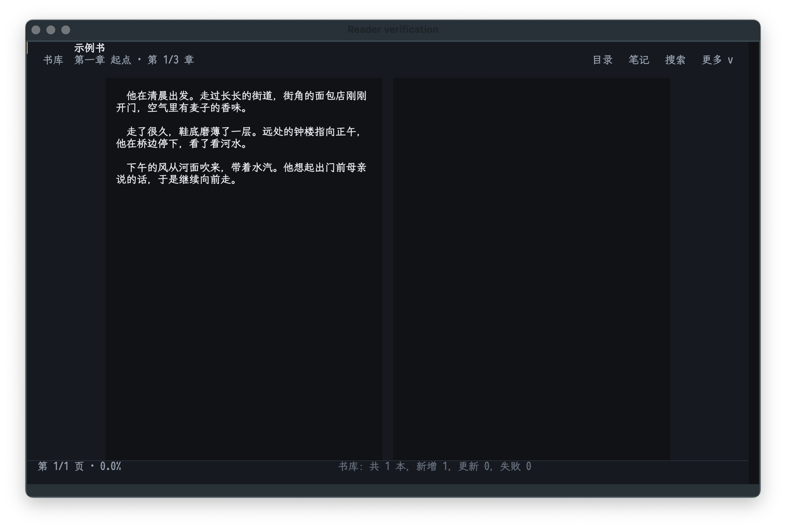
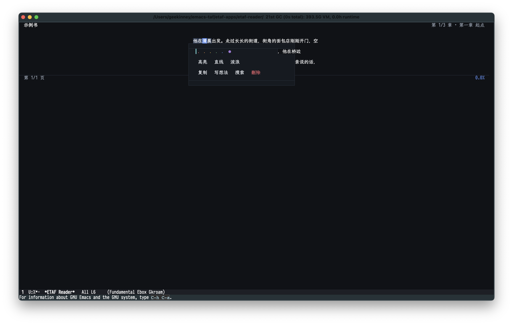

# ETAF Reader

ETAF Reader is a local ebook reader for Emacs. It scans a library directory for
EPUB, TXT, Markdown, HTML, FB2 and PDF files, imports them into one SQLite
library through [ETAF DB](https://forgejo.vhkd.top/emacs-taf/etaf-db), and reads
them with an adaptive paged or scrolling layout built from
[ETAF](https://forgejo.vhkd.top/emacs-taf/etaf) and
[Ebox](https://forgejo.vhkd.top/emacs-taf/ebox): select text with the mouse or the
keyboard, then mark it with a highlighter color, a straight underline or a wavy
underline, attach thoughts, jump through the table of contents and notes, and
resume exactly where the last session stopped.



Selected text opens the annotation toolbar above or below the line:



## Capabilities

- Library: scans `etaf-reader-library-directories` (default `~/ebooks`),
  stores metadata and chapter text in SQLite, and shows a shelf with progress,
  reading state and per-book format, pages and chapter counts. Search titles
  and authors, filter reading states, sort the shelf and page through every
  result; imported covers are shown when available.
- Formats: EPUB 2/3, TXT, Markdown, HTML, FB2 and PDF, parsed by the
  `ebook-parse` skill; PDF needs poppler's `pdftotext`/`pdfinfo`.
- Reading: paged mode (one column on narrow frames, two columns on wide ones)
  or scrolling mode, adjustable column width, six annotation colors, and three
  palettes (dark, light, sepia). A reading toolbar and persisted settings expose
  these choices along with comfortable or compact paragraph spacing.
- Annotations: mouse drag or the `v` keyboard selection mode opens a floating
  toolbar above or below the line; highlights, straight and wavy underlines and
  thoughts anchor on (chapter, code point) pairs, so they survive re-wrapping,
  font changes and window resizes.
- Navigation: paged contents, notes, search-result and bookmark lists, in-book
  search with `n`/`N`, percentage jumps and return-to-previous-location.
- Progress: chapter and offset are saved per book with reading time; the shelf
  shows percent and last-read time, and a book reopens where it was left.
- Export: annotations of the current book are written as Markdown.

## Prerequisites

| Requirement | Why | Check |
| --- | --- | --- |
| Emacs 29.1 or newer | the ETAF runtime and built-in SQLite support | `emacs --version` |
| `etaf`, `etaf-ui`, `etaf-db`, `ebox`, `ecss` | the framework; each root entry must be on `load-path` | every checkout is readable |
| `ebook-parse` skill | parses local ebook files | `pi-skill ebook-parse check` |
| poppler | PDF text extraction | `pdftotext -v` |

## Installation

```elisp
(add-to-list 'load-path "/path/to/ecss")
(add-to-list 'load-path "/path/to/ebox")
(add-to-list 'load-path "/path/to/etaf")
(add-to-list 'load-path "/path/to/etaf-ui")
(add-to-list 'load-path "/path/to/etaf-db")
(add-to-list 'load-path "/path/to/etaf-reader")
(require 'etaf-reader)

(global-set-key (kbd "C-c e") #'etaf-reader-open)
```

`M-x etaf-reader-open` mounts the reader on its shelf; `M-x
etaf-reader-open-file` imports and opens one file. Point
`etaf-reader-library-directories`, `etaf-reader-store-file`,
`etaf-reader-theme` and `etaf-reader-parser-command` at your own setup.

The parser is found automatically: `etaf-reader-parser-command` first, then
`PI_READER_PARSER`, the installed `ebook-parse` command, then the shared skill
checkout under `~/.pi/agent/skills/ebook-parse`.

Without a Pi checkout, install the parser as a standalone CLI:

```sh
git clone https://forgejo.vhkd.top/pi-hub/ebook-parse-cli.git
cd ebook-parse-cli && ./scripts/install-cli.sh   # links ~/.local/bin/ebook-parse
```

## Minimal example

```elisp
(let ((session (etaf-reader-create)))
  (etaf-reader-refresh-library session)
  (when-let* ((book (car (etaf-reader-books session))))
    (etaf-reader-open-book session book))
  (etaf-reader-open session))
```

## Keys

| Key | Action |
| --- | --- |
| `SPC` / `PgDn` | next page (or three lines while scrolling) |
| `DEL` / `PgUp` | previous page |
| `j` / `k` | one line down / up |
| `h` / `l` | previous / next chapter (moves the selection while `v` is active) |
| `v`, then `hjkl`, `RET` | keyboard selection and its toolbar |
| `s` / `n` / `N` | in-book search, next match, previous match |
| `c` / `a` / `B` / `S` | contents / notes / bookmarks / search results |
| `b`, `g`, `u` | bookmark the page, jump to a percentage, return before a jump |
| `o`, `C-g` | reading settings, close the current pane/selection |
| `z`, `[`, `]`, `t` | mode, width, width, palette |
| `f`, `i`, `E`, `?`, `q` | shelf, rescan, export notes, help, close |

## Checks

```sh
make check    # structure + byte compilation (warnings as errors) + acceptance + API boundary
make test     # the public acceptance scenarios only
```

The acceptance suite drives a scripted parser and a temporary SQLite database,
so it needs no network, backend process or frame.

## Documentation

- [The manual](docs/manual.md): library, reading, annotations, themes,
  scripting and troubleshooting.
- [Architecture](docs/architecture.md): module responsibilities, data flow and
  invariants.
- [The root entry Commentary](etaf-reader.el): the authoritative list of
  supported functions and variables.
